# Plataforma C: Escape from Floripa

## ▶ Jogue agora: **https://escape-from-floripa.negoci.online**

Roda direto no navegador (computador ou celular deitado), sem instalar nada. Single player, multiplayer online para dois jogadores e placar global.

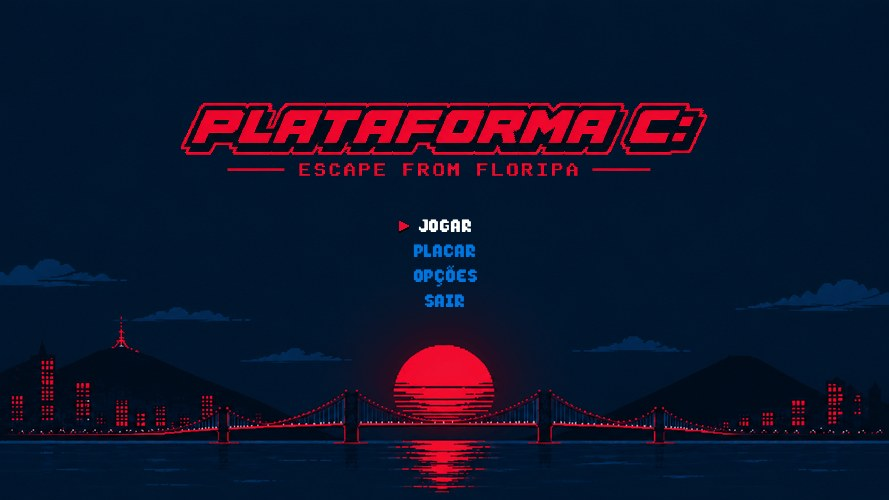

---

## O jogo

No ano de 2067, uma IA chamada **Floria** assumiu o controle do Centro de Florianópolis para otimizar a decadente mobilidade urbana manezinha. Drones de fiscalização, patinetes e bicicletas elétricas, gaúchos de espada e a Guarda Municipal com implantes cibernéticos perseguem qualquer pessoa que tente atravessar a cidade. O objetivo: chegar à **Plataforma C do TICEN** e pegar o **763.2 via Kobrasol** para fugir de Florianópolis.

**Gênero:** roguelike top-down de ação. O personagem atira sozinho no inimigo mais próximo; o jogador se move, desvia com o dash e escolhe cartas de melhoria entre as hordas.

### As salas

| Sala | Lugar | O que acontece |
|---|---|---|
| I | Rua dos bares (TCHAY, Gatus Rock Bar, Bar do Noel) | Primeiras hordas, fila do TCHAY, bueiro secreto para o esconderijo dos gaúchos |
| II | O Antigo Terminal e o Piranhas Bar | Horda contínua, cardápio do Piranhas Bar, fresta secreta para a dungeon procedural |
| III | Praça XV (Figueira, Catedral, monumento) | Hordas mais fortes e cartas exclusivas da sala |
| IV | Mercado Público | Skatistas e comerciantes, interior do Mercado, fliperama com minigame |
| V | TICEN | Chefe final: o **Golem de Topázio**; no multiplayer, o duelo pela última vaga do ônibus |

| | |
|---|---|
| 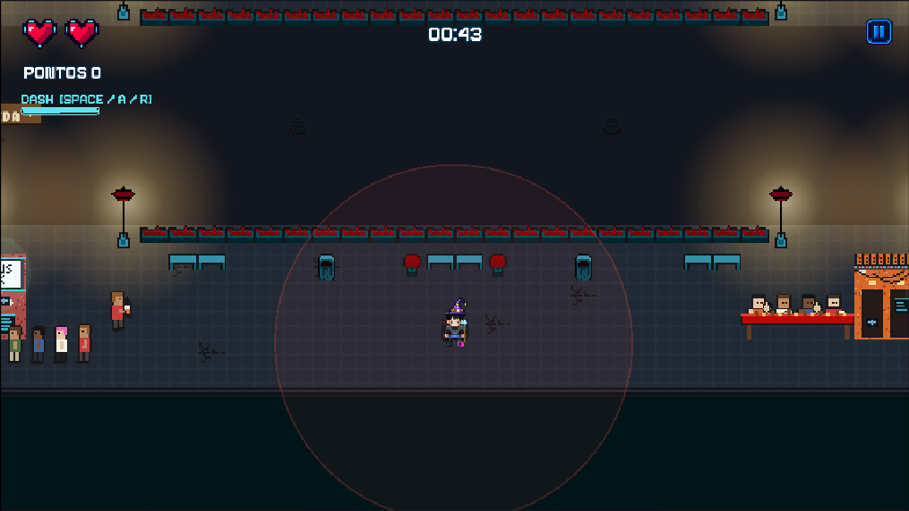 | 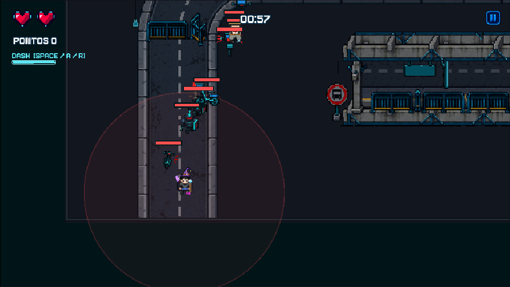 |
| **Sala I:** rua dos bares | **Sala II:** o Antigo Terminal |
| 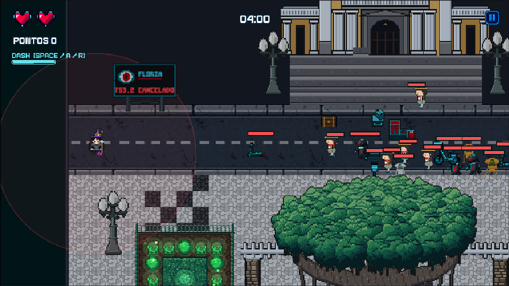 | 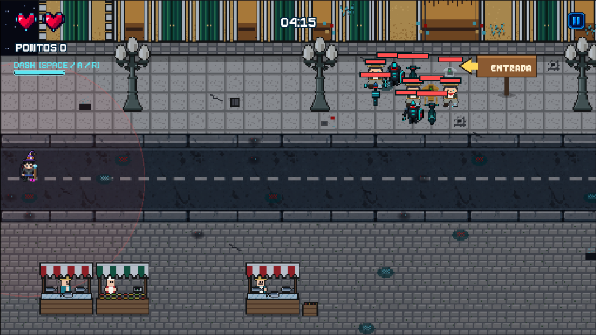 |
| **Sala III:** Praça XV | **Sala IV:** Mercado Público |
| 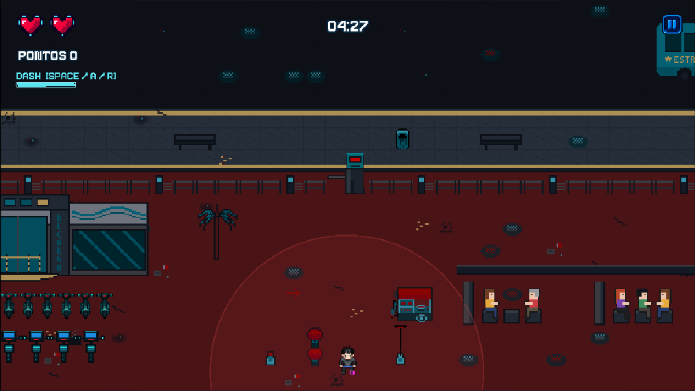 | 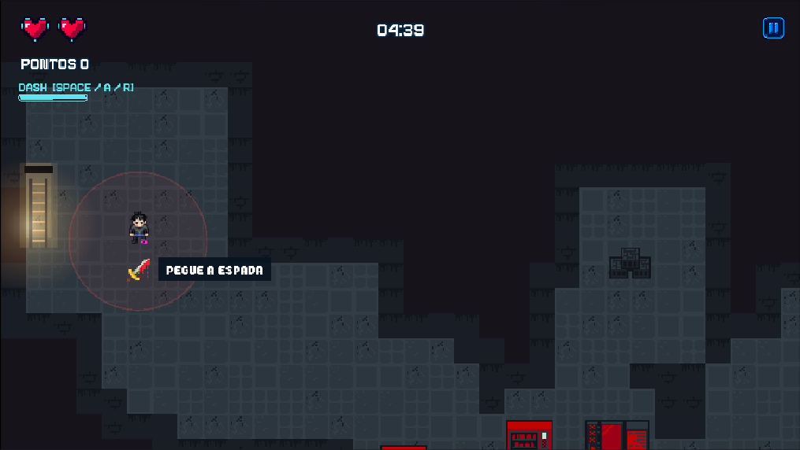 |
| **Sala V:** TICEN | **Esconderijo dos gaúchos** (subsolo) |

### Chefe final e fuga

| | |
|---|---|
| 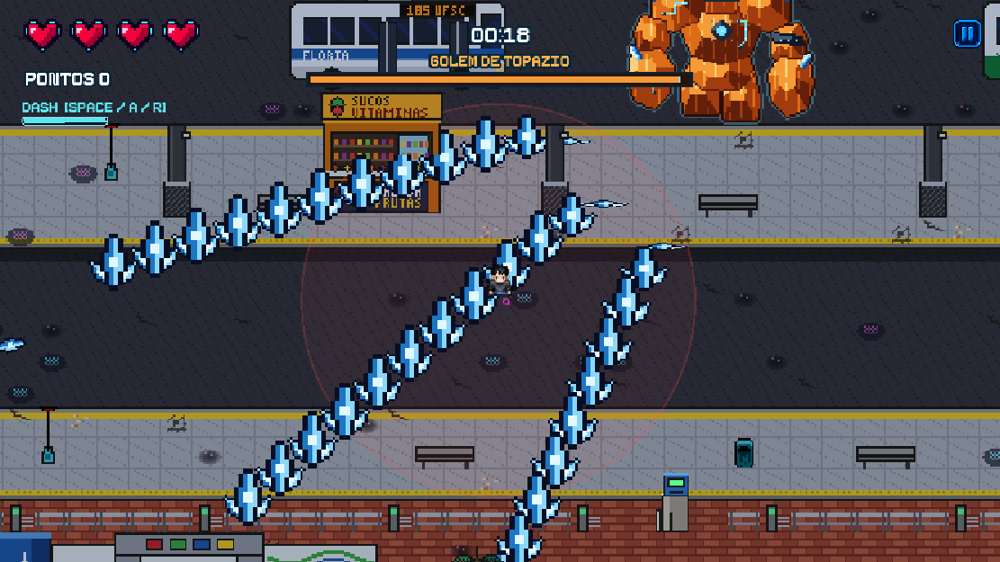 | 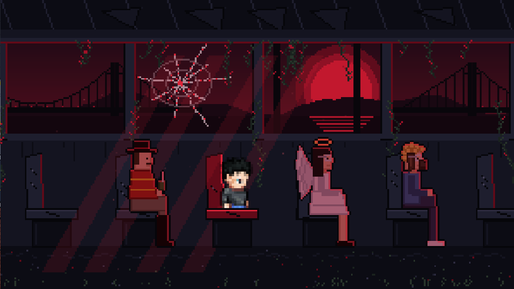 |
| O Golem de Topázio racha em quatro estágios conforme perde vida | A fuga no 763.2 |
| 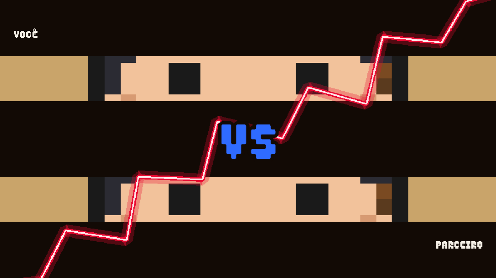 | 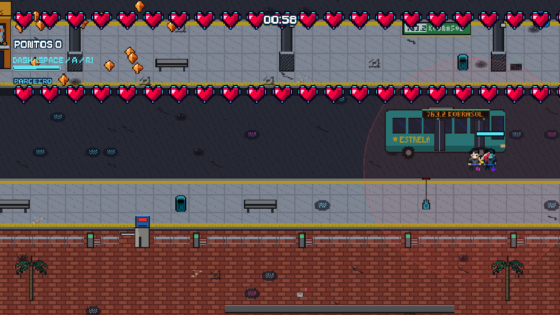 |
| Multiplayer: só um embarca, e a dupla decide no duelo | A disputa 1x1 com baús de especiais |

### Progressão

- **Cartas de melhoria** entre as hordas (cadência, dano, tiro duplo, perfuração, drone companheiro, poderes em área como serras orbitais, raios, feixes, bombardeio e rajada espiral). A Sala III tem cartas fortes exclusivas.
- **Itens de equipar** com inventário (tecla **I**), arrastando para o boneco: chapéu de gaúcho, capacete, galochas, botas de prata e de diamante, espada flamejante, cajado de gelo, armadura de ferro, capa de vampiro e chapéu de mago. Os itens aparecem no personagem e no parceiro.
- **Baús especiais** que só abrem se a sala for vencida dentro do tempo.
- **Dois personagens:** o padrão e o gaúcho, com proporções próprias. Os itens são desenhados na medida de cada um.
- **Piranhas Bar:** gin tropical, gin de melancia e cookie mágico.
- **Dungeons secretas:** o esconderijo dos gaúchos (combate só de espada) e uma dungeon gerada proceduralmente por seed (ver [extensoes.md](extensoes.md)).

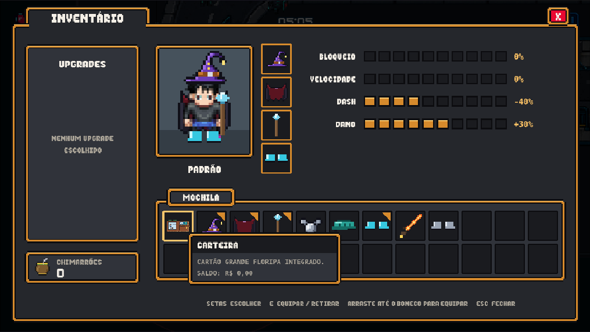

### Controles

| Ação | Teclado | Controle USB |
|---|---|---|
| Mover | WASD ou setas | D-PAD |
| Dash | Espaço | A / R |
| Golpear com a espada | Botão direito do mouse | B |
| Inventário | I | — |
| Piranhas Bar | G | B |
| Pausar | P | START |

No celular aparecem joystick e botões na tela, e o jogo entra em tela cheia com o aparelho deitado.

### Multiplayer e placar

- **Multiplayer online:** JOGAR > MULTIPLAYER. Um jogador cria a sala e o outro entra pela lista ou pelo nome. Inimigos, tiros, vida, cartas, itens e efeitos são sincronizados; quem cai pode ser revivido pelo parceiro.
- **Placar:** só vitórias entram no ranking, separado em solo e dupla. A pontuação é recalculada no backend a partir do relógio registrado pela API.

---

## Arquitetura

| Parte | Tecnologia | Onde |
|---|---|---|
| Jogo | Phaser 4, TypeScript, Parcel 2 | `game/` |
| Servidor multiplayer | Node.js + WebSocket, em EC2 | `server/` |
| Placar | Python em Lambda, API Gateway e DynamoDB | `backend/` |
| Infraestrutura | Pulumi (Python): S3, CloudFront, ACM, Route 53, EC2 | `pulumi/` |
| Documentação | GDD, requisitos, regras de negócio, casos de uso, diagramas | `docs/` |
| Vídeo de abertura | HyperFrames | `video/intro/` |

O CloudFront entrega o jogo e encaminha `/api/*` para o placar e `/ws` para o servidor multiplayer, tudo no mesmo domínio. Cada merge na `main` publica o jogo pelo GitHub Actions; mudanças em `server/`, `backend/` ou `pulumi/` exigem `pulumi up` (um workflow avisa no PR). Passo a passo em [docs/deploy-aws.md](docs/deploy-aws.md).

## Como rodar localmente

```bash
cd game
npm install
npm run dev-nolog   # http://localhost:1234
npm test            # testes (node:test)
```

Multiplayer na mesma rede: na raiz, `npm run lan` e abra nos dois computadores o endereço exibido (por exemplo `http://192.168.1.42:8080`). Detalhes em [docs/como-rodar.md](docs/como-rodar.md).

---

## Considerações e ajustes para o professor

- **Endereço oficial:** https://escape-from-floripa.negoci.online. O domínio é o delegado pelo professor e a zona fica na conta AWS da equipe.
- **Atalhos de teste (ativos também em produção):** digitar `9090` nas Salas I a IV elimina a horda atual e encerra o combate, liberando a saída; `8080` na Sala III dá uma carta forte. O atalho `?room=N` na URL só funciona em desenvolvimento (bloqueado no build de produção pelo PR #41).
- **Login com Google e Feira de Jogos (PR #40, em andamento):** usa o Client ID da feira. Para o login funcionar é preciso cadastrar em *Authorized JavaScript origins* os endereços `https://escape-from-floripa.negoci.online` e `http://localhost:1234`, e liberar o CORS do `POST /api/v2/credit` para o nosso domínio. Quem vence logado recebe 100 tijolinhos (produto 97).
- **Hospedagem dentro da feira:** o build usa caminhos relativos, então funciona numa subpasta de `feira-de-jogos.dev.br`. No PR #40, o placar e o multiplayer passam a apontar para o nosso domínio quando o jogo roda em HTTPS, e o servidor multiplayer aceita a origem da feira.
- **`pulumi up` pendente:** os PRs #40 e #41 mexem no servidor multiplayer (origem da feira e limite de itens vestidos). Até o `pulumi up` rodar, o servidor em produção continua com as regras antigas.
- **Feira de jogos sem login:** sem login, nenhum crédito é enviado; o pagamento fica manual.
- **Extensão do trabalho:** dungeon procedural por seed, descrita em [extensoes.md](extensoes.md).

---

## Referências

**Gameplay:** Vampire Survivors (hordas e builds), Soul Knight (visão top-down, salas e combate), Endless Wander.

**Arte e clima:** Akira e NieR: Automata (estética futurista e decadente); paleta cyberpunk nas salas da rua.

**Lugares reais do Centro de Florianópolis:** TCHAY, Gatus Rock Bar, Bar do Noel, Terminal Cidade de Florianópolis (antigo), Centro Cultural da Marinha, Piranhas Bar, Praça XV com a Figueira e a Catedral Metropolitana, Mercado Público, TICEN e a linha 763.2 Kobrasol.

**Golem de Topázio e final:**

| | | | |
|---|---|---|---|
| 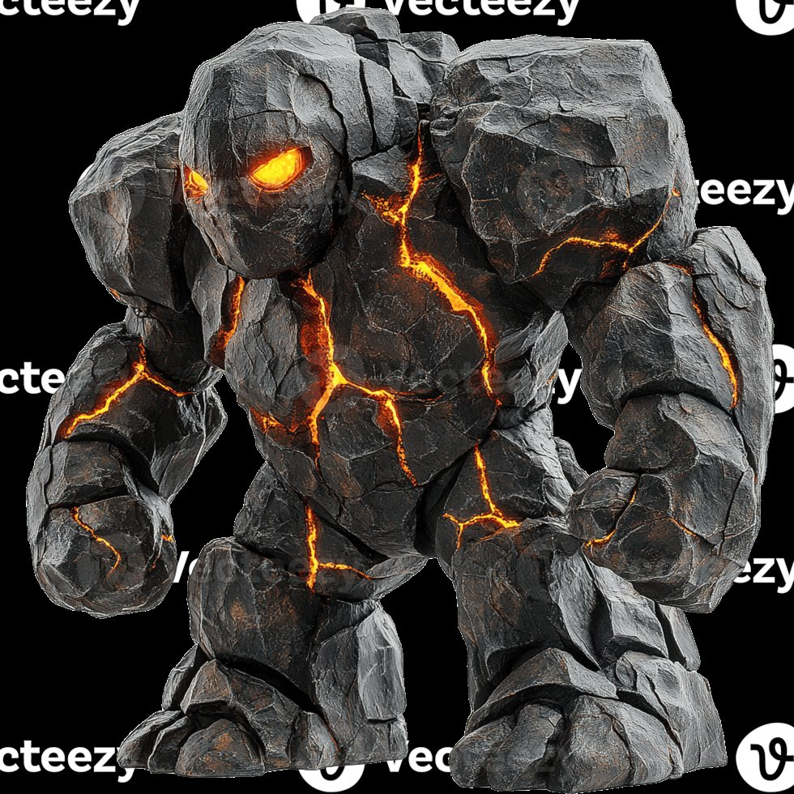 | 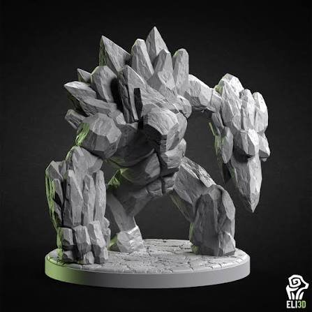 |  | 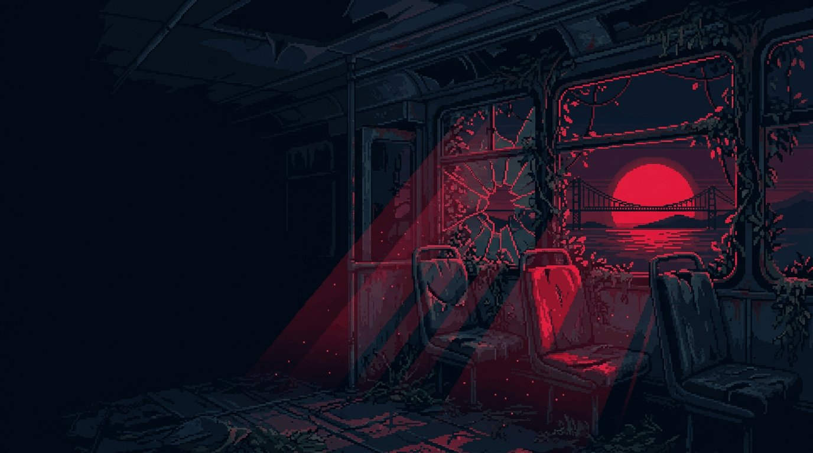 |
| Golem de rocha | Golem de cristal | Topázio imperial | Ônibus abandonado |

**Duelo do multiplayer:** close dos olhos no estilo dos duelos de faroeste.

| | |
|---|---|
| 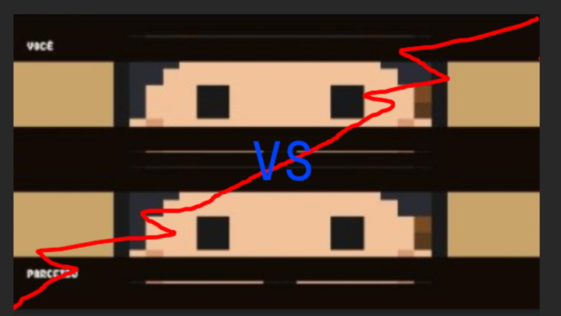 |  |

Documentação completa: [GDD](docs/gdd.md) · [Requisitos](docs/requisitos.md) · [Regras de negócio](docs/regras-de-negocio.md) · [Casos de uso](docs/casos-de-uso.md) · [Diagrama da nuvem](docs/diagrama-nuvem.md) · [API do placar](docs/api-placar.yaml)

## Equipe

Lucas de Leon e Victor Lacerda, para a disciplina de TES do IFSC.
