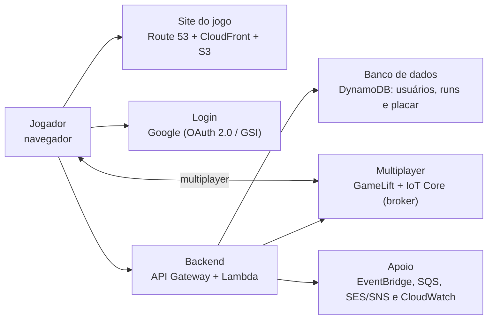

# Arquitetura de nuvem AWS

Esta é uma proposta simples de arquitetura para o jogo **Plataforma C: Escape from Floripa**. A ideia é colocar o jogo web na AWS, guardar usuários e placar com segurança e deixar preparado o caminho para o multiplayer.

## Diagrama

## Explicação

- **Site do jogo:** o jogador acessa um endereço do Route 53. O CloudFront entrega o frontend e os arquivos do jogo (imagens, sons e mapas), que ficam no S3. O CloudFront também fornece HTTPS.

- **Login:** o jogador entra com a conta Google (Google Identity Services, OAuth 2.0), com o mesmo Client ID da Feira de Jogos do IFSC. O ID token identifica o usuário no placar, validado pelo API Gateway, e autoriza o crédito de tijolinhos na API da feira quando ele termina o jogo. Jogar sem entrar continua possível, sem placar nem crédito.

- **Backend:** o frontend chama a API REST no API Gateway. As funções Lambda executam as regras que precisam ficar na nuvem, como iniciar/finalizar uma run, salvar o tempo e consultar o placar. O DynamoDB guarda usuários, runs vencedoras e o ranking.

- **Placar:** somente runs vencidas são salvas. A Lambda calcula a pontuação com a versão da fórmula e com os horários de início e fim registrados no backend. O ranking separa modalidade e versão, mantém um resultado por jogador e ordena por maior pontuação, menor tempo e conclusão mais antiga.

- **Multiplayer:** o GameLift Servers é o serviço da AWS voltado a hospedar partidas. O IoT Core funciona como o **broker**: recebe mensagens dos jogadores e distribui as atualizações da partida. O GameLift valida as ações importantes, como vitória e derrota.

- **Notificações e logs:** quando algo importante acontece, como uma run concluída, o EventBridge e o SQS enviam o evento para processamento sem atrasar o jogo. SES pode enviar e-mails e SNS notificações. CloudWatch guarda logs e ajuda a encontrar erros.

