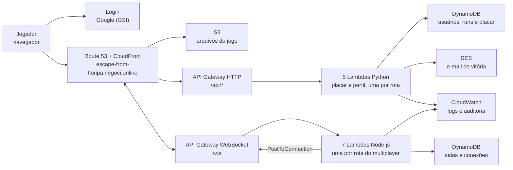

# Arquitetura de nuvem AWS

Arquitetura do **Plataforma C: Escape from Floripa** como está implementada em `pulumi/__main__.py`. Tudo é serverless: nada fica ligado esperando jogador, e o custo acompanha o uso.

## Diagrama

## Explicação

- **Site do jogo:** o Route 53 aponta o domínio para o CloudFront, que entrega o jogo guardado num bucket S3 privado e cuida do HTTPS. Os arquivos do build são recursos do Pulumi: o mesmo `pulumi up` publica jogo, placar e multiplayer a partir do mesmo commit.

- **Login:** o jogador entra com a conta Google (Google Identity Services), com o Client ID da Feira de Jogos do IFSC. O API Gateway valida o ID token nas rotas de escrita do placar. Jogar sem entrar continua possível, sem placar.

- **Placar:** o API Gateway HTTP roteia cada rota para uma Lambda própria (`start_run`, `finish_victory`, `discard_run`, `leaderboard` e `save_profile`, em `backend/`). Cada função leva só o próprio arquivo, o `common.py` e a fórmula (`score.py`). Só runs vencidas ficam salvas: a Lambda calcula a pontuação com os horários registrados no backend, e o ranking mantém o melhor resultado de cada jogador.

- **Multiplayer:** o API Gateway WebSocket mantém as conexões dos jogadores e escolhe a rota pelo campo `type` da mensagem (`lobby.join`, `lobby.list`, `player.state`, `match.event`, além de `$connect`, `$disconnect` e `$default`). Cada rota chama uma Lambda (`server/src/lambda/`), que guarda salas e conexões no DynamoDB e responde aos jogadores com `PostToConnection`. As regras ficam em `server/src/multiplayer.js`, as mesmas do servidor local de desenvolvimento.

- **E-mail:** quando um jogador logado vence, a Lambda de vitória manda um e-mail pelo SES, com o domínio verificado por DKIM na zona do Route 53.

- **Logs:** o CloudWatch guarda o log de acesso da API e uma linha JSON por operação crítica (início, vitória e descarte de run, entrada em sala, desconexão).

## Por que não EC2 nem GameLift

O multiplayer já rodou numa EC2 `t4g.micro`, cobrada 24 horas por dia mesmo sem jogadores (cerca de US$ 10 a 15 por mês com o IP fixo). O GameLift serve para servidores de jogo autoritativos, e aqui o servidor só repassa mensagens entre os dois jogadores de uma sala. Com WebSocket no API Gateway e Lambda, o custo é por mensagem e por minuto de conexão, e zero sem partidas.

Limites desta escolha:

- Uma conexão WebSocket do API Gateway cai após 10 minutos sem mensagens, o que não acontece: na partida o jogo manda 20 estados por segundo, e a espera por um parceiro termina em 5 minutos. A conexão também dura no máximo 2 horas, então uma partida mais longa que isso cai.
- Cada mensagem passa por uma Lambda, o que soma alguns milissegundos à latência em relação a um servidor sempre ligado.
- Cada jogador envia 20 estados por segundo e o anfitrião ainda envia os inimigos. Uma hora de partida dá cerca de 200 mil chamadas de Lambda e 400 mil mensagens no API Gateway, algo entre US$ 0,50 e US$ 1. Acima de umas 20 horas de partida por mês, a EC2 voltaria a sair mais barata.
